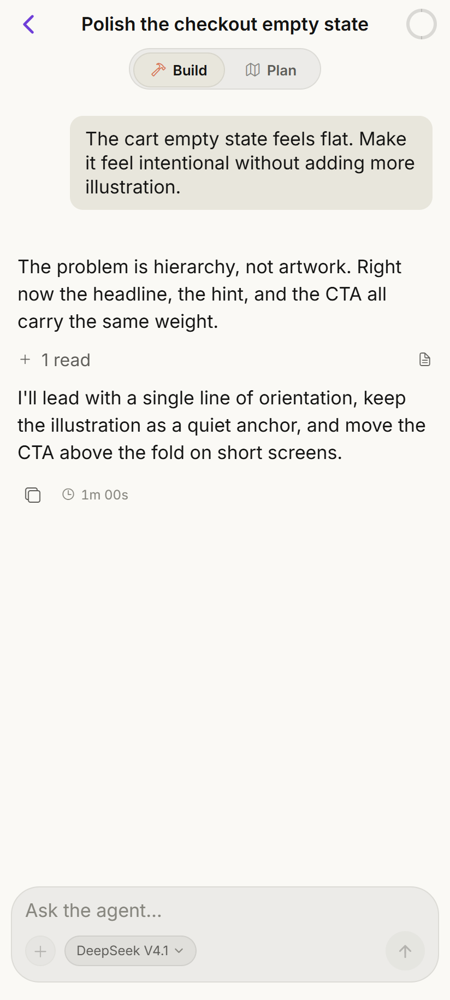
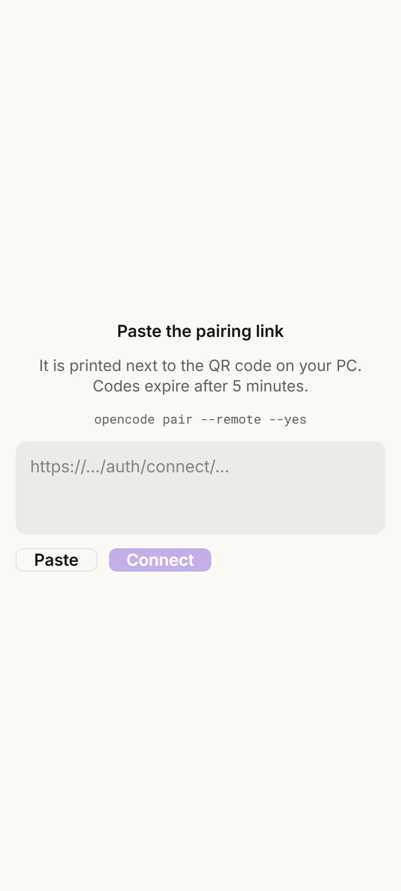
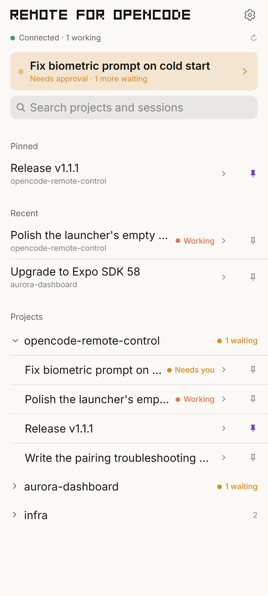
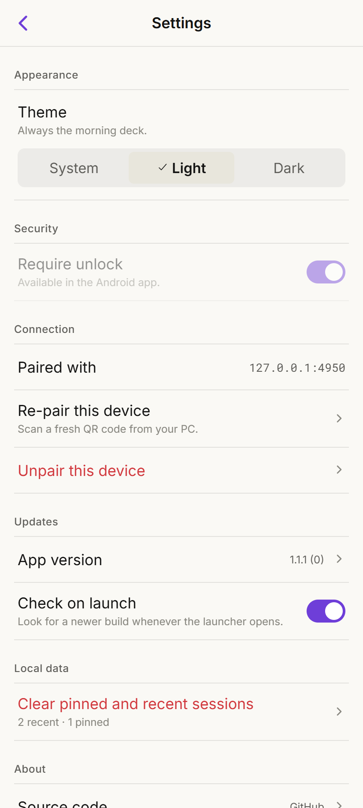
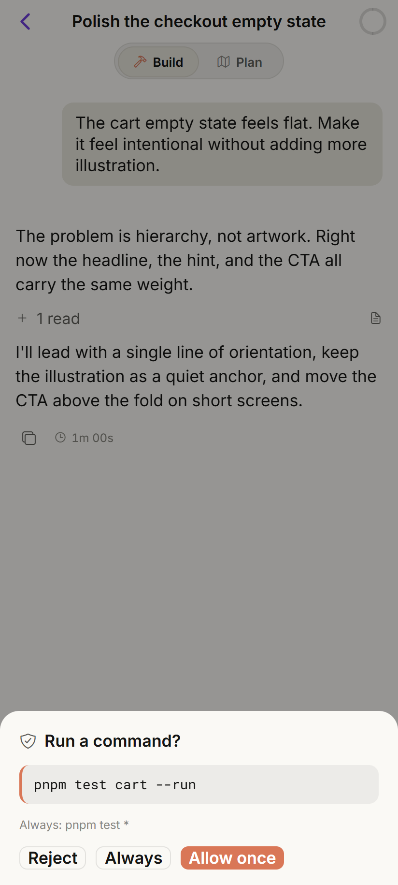

# OpenCode Remote

**Your OpenCode sessions, in your pocket.**

An Android app that talks directly to the OpenCode server on your PC over the official `opencode pair --remote` tunnel. Watch a session stream, send a prompt, stop a run, or approve a tool call — from anywhere with a connection.

[](https://github.com/yassine808/opencode-remote-control/actions/workflows/ci.yml)
[](https://github.com/yassine808/opencode-remote-control/actions/workflows/codeql.yml)
[](https://github.com/yassine808/opencode-remote-control/releases/latest)
[](LICENSE)
[](#requirements)

<p align="center">
  
</p>

<p align="center">
  <b><a href="https://github.com/yassine808/opencode-remote-control/releases/latest">Download the latest APK →</a></b>
</p>

## Why

OpenCode runs on your machine, which is exactly where you are not. This app is the control deck: it shows what the agent is doing, lets you steer it, and keeps the approval boundary in your hand. There is no bridge process and no custom relay — the phone speaks the same HTTP API as the TUI, through the tunnel OpenCode already knows how to open.

## Features

- **Live sessions** — every project and session, with running, idle, and *needs you* state at a glance.
- **Streaming transcript** — text and reasoning deltas, tool calls with inputs and output, token and cost counters.
- **Steer or stop** — send another prompt into a running turn, or interrupt it.
- **Approvals that read** — allow once / always / reject, with the exact command and a card that changes with risk.
- **Model switching** — pick the model and effort level from the session header.
- **Stays paired** — the token renews itself before it expires, so you are not walking back to the PC every month.
- **Self-update** — checks GitHub Releases, downloads the new APK, and hands it to Android's installer.
- **App lock** — biometrics or the device passcode on launch and after leaving the foreground; switch it off in Settings.
- **Light, dark, or system** — follow the phone, or pin the deck to the morning or night palette; the choice survives launches.
- **Mobile data first** — no port forwarding, no LAN mode, no same-Wi-Fi requirement.

## Install

1. Open [Releases](https://github.com/yassine808/opencode-remote-control/releases/latest) and download the newest `.apk`.
2. Tap it. Android will ask you to allow installs from the browser or file manager.
3. Open **OpenCode Remote** and pair (below).

The APK is release-signed, so a newer build installs over an older one. The tag and asset name carry the Android `versionCode` (`v1.1.2-6` → `opencode-remote-1.1.2-6.apk`); that code always increases.

## Pair

On the PC, with OpenCode v2 running:

```bash
opencode pair --remote --yes
```

This exposes the local server through a public OpenTunnel URL and prints a QR code and two links.

On the phone:

- tap **Scan QR** and scan the terminal QR, **or**
- paste the public `https://…` link — or the whole terminal block; the app finds the public URL and ignores the loopback one.

The app exchanges the single-use code for a token and stores it in Android SecureStore.

To re-pair or unpair later, open **Settings** from the home screen: **Re-pair this device** scans a fresh QR code, and **Unpair this device** clears the token from the phone.

> [!WARNING]
> Pairing codes are **single-use** and expire after **five minutes**. Do not open the link on the PC first: any visit spends the code, and the phone will report `Pairing link expired or already used`. If that happens, run `opencode pair --remote --yes` again for a fresh code.

> [!NOTE]
> The `http://127.0.0.1:<port>/auth/connect/…` line only works on the PC. The phone must use the `https://<random>.opentunnel.xyz` link. The app filters loopback addresses automatically, and the first public URL that answers wins.

<p align="center">
  
</p>

## A look around

| Sessions | Settings | Approvals |
| --- | --- | --- |
|  |  |  |

## How it works

```
Android app (Expo / React Native)
   │  HTTPS + Basic auth (paired token)
   ▼
OpenTunnel public URL   ← created by `opencode pair --remote`
   │
   ▼
OpenCode server on the PC
   ├─ sessions · messages · prompts · interrupt
   ├─ models and effort levels
   └─ permission requests   ← the safety boundary
```

No custom bridge: the app consumes OpenCode's own HTTP API and its SSE stream (`GET /api/event`), through the official tunnel. Pairing is the official one-time code exchange. Before the token expires, the app mints a fresh one through the same API — the server's password is never stored on the phone.

## Requirements

- A PC running **OpenCode v2** with remote pairing available.
- An **Android** phone. The app is built with Expo SDK 58 and sideloaded as an APK; there is no Play Store listing.
- The PC stays awake and online while you are away. Disable sleep for the session: `powercfg /change standby-timeout-ac 0`.

## Build from source

```bash
git clone https://github.com/yassine808/opencode-remote-control.git
cd opencode-remote-control/mobile
npm ci
npm run typecheck
npm run lint
npm run web          # browser preview at http://localhost:8977
```

To run on a phone during development:

```bash
npm run start -- --tunnel   # then open the project in Expo Go
```

The signed release APK is built by [`.github/workflows/android-release.yml`](.github/workflows/android-release.yml). Bump `expo.version` and `expo.android.versionCode` in [`mobile/app.json`](mobile/app.json), then:

```bash
gh workflow run android-release.yml -f release_notes="What changed…"
```

The workflow expects four repository secrets: `ANDROID_KEYSTORE_BASE64`, `ANDROID_KEYSTORE_PASSWORD`, `ANDROID_KEY_ALIAS`, and `ANDROID_KEY_PASSWORD`. It publishes the APK and tags the commit.

## Optional: PC-side indicator

`plugins/rc-dot/` is an OpenCode CLI plugin that draws a green `● RC active` or red `● RC disabled` dot in the TUI footer, so you can see from the desk whether a remote client is connected.

```powershell
# from a clone of this repo, on Windows
New-Item -ItemType Directory -Force "$env:USERPROFILE\.config\opencode\plugins" | Out-Null
Copy-Item -Recurse .\plugins\rc-dot "$env:USERPROFILE\.config\opencode\plugins\"
```

Restart OpenCode. See [`plugins/rc-dot/README.md`](plugins/rc-dot/README.md) for how detection works and how to change the port or allow-list.

## Security

A remote prompt runs code on the PC as your user. **Approvals are the entire safety boundary.**

- Keep `bash` and `edit` set to `ask` in `~/.config/opencode/opencode.json`. Do not weaken them for convenience.
- Use a long random server password before turning remote access on. Changing it signs out every device — that is also the lost-phone procedure, because there is no per-device revoke yet.
- Run OpenCode as a normal user, not as Administrator.
- The pairing token lives in Android SecureStore. The web preview falls back to `localStorage` for development only.
- The app locks behind device authentication, but that protects the phone, not a compromised PC.
- Turn remote access off when you are done: `opencode service set remote false`.

## Troubleshooting

| What you see | What it means | Fix |
| --- | --- | --- |
| `Pairing link expired or already used` | The one-time code was spent or passed five minutes | Run `opencode pair --remote --yes` again and scan the new QR. Do not open the link on the PC first. |
| `Pairing failed: …` | The app tried each public URL and shows why each one failed | Check that the phone has internet and the tunnel is up. Try mobile data if Wi-Fi blocks the tunnel. |
| `PC unreachable` | The tunnel closed, the PC slept, or OpenCode stopped | Wake the PC, confirm OpenCode is running, re-run the pair command if the tunnel is gone. |
| The QR will not scan | Camera permission or a screen reflection | Tap **Enter link manually** and paste the public `https://…` link. |
| An old build cannot pair after pasting the whole terminal block | Fixed in **1.1.1**: earlier builds could pick the PC-only `127.0.0.1` URL | Update from [Releases](https://github.com/yassine808/opencode-remote-control/releases/latest). |
| Android blocks the APK | Unknown-source installs are off for that app | Allow installs for the browser or file manager, then retry. |

## Checks

Every push to `main` and every pull request runs:

- **Typecheck** — `tsc --noEmit`
- **Lint** — `expo lint`
- **Expo Doctor** — dependency and SDK alignment
- **Web build** — a full `expo export --platform web`
- **Android prebuild** — config plugins and native project generation
- **Workflow lint** — actionlint across `.github/workflows`
- **CodeQL** — JavaScript/TypeScript security analysis

## Layout

```
mobile/              Expo SDK 58 app (expo-router, React Native 0.88, React 19)
plugins/rc-dot/      OpenCode TUI plugin: remote-connection indicator
docs/screenshots/    README images
.github/workflows/   CI, CodeQL, and the signed APK release
PLAN.md              as-built architecture and API notes
DESIGN.md            "The Flight Deck" design system
PRODUCT.md           product and interface principles
TO-DO.md             backlog
```

## Status

A personal, Android-only v1. iOS, LAN mode, and push notifications are not implemented; see [`TO-DO.md`](TO-DO.md) and [`PLAN.md`](PLAN.md).

## License

[MIT](LICENSE) © 2026 Yassine
